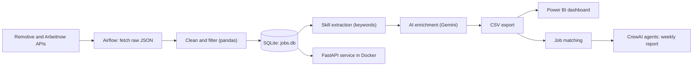

# Job Market Intelligence Platform

A data pipeline that collects data-job postings every day, finds the skills employers ask for, uses AI to judge each role's level, matches jobs against a candidate's skills, and shows the results in a Power BI dashboard and a REST API.

## What it does

- Collects job postings daily from two public job APIs.
- Cleans the data and keeps only data-related roles.
- Extracts the skills each job asks for.
- Uses an LLM (Gemini) to label each job's level (entry, mid, senior) and whether a beginner could apply.
- Matches jobs against a candidate skill profile and finds the most common missing skills.
- Uses two CrewAI agents to turn those numbers into a short weekly report.
- Serves the results through a FastAPI service running in Docker.
- Shows everything in a Power BI dashboard.

## Architecture



## Pipeline in Airflow


The DAG `fetch_jobs_daily` runs seven tasks in order: fetch, clean, extract skills, AI enrichment, export, match jobs, career report.

## Dashboard


## Results so far

- 301 job postings collected between 3 and 7 November 2026, growing daily.
- The most requested skills so far are Python, machine learning, LLMs, SQL, data visualization and ETL.

## Tech stack

| Area | Tools |
|---|---|
| Orchestration | Apache Airflow |
| Data processing | Python, pandas, SQLite, SQL |
| AI | Google Gemini API, CrewAI |
| API | FastAPI, Uvicorn |
| Packaging | Docker, Docker Compose |
| Cloud | AWS EC2, S3, IAM |
| Dashboard | Power BI (DAX measures, slicers, custom theme) |

## API

| Endpoint | Returns |
|---|---|
| `/health` | Service status |
| `/skills/top` | Most requested skills |
| `/jobs` | Jobs, filterable by level, remote and title search |
| `/matches` | Best matches for the candidate profile |
| `/report` | Latest weekly report |

Interactive docs are available at `/docs` when the service is running.

## Project structure

```
dags/        Airflow DAG
src/         Fetch, clean, skill extraction, AI enrichment, export, matching
agents/      CrewAI agents and candidate profile
api/         FastAPI service
dashboard/   Power BI file and theme
docs/        Screenshots
```

## Run it yourself

1. Get a free Gemini API key from Google AI Studio.
2. Create a `.env` file in the project folder:
   ```
   AIRFLOW_UID=50000
   GEMINI_API_KEY=your_key_here
   ```
3. Edit `agents/my_profile.json` with your own skills.
4. Start Airflow:
   ```
   docker compose up airflow-init
   docker compose up -d
   ```
5. Open http://localhost:8080 (user `airflow`, password `airflow`) and trigger `fetch_jobs_daily`.
6. Start the API:
   ```
   docker compose -f docker-compose.api.yaml up -d --build
   ```
7. Open http://localhost:8000/docs.

## Design decisions

- Raw API responses are saved untouched, so cleaning can be redone at any time.
- The AI reads at most 20 new jobs per run and never reads the same job twice, to stay inside free-tier limits.
- Matching scores are calculated in code. The agents only explain the numbers, so results are exact and AI calls stay few.
- Only skill names are sent to the AI. No personal details leave the machine.

## Limitations

- The dataset covers days, not months, so trends are not meaningful yet.
- Skill extraction by keywords can miss skills written in unusual ways.
- AI level labels can be wrong, and only some jobs have been labelled so far.
- The sources are mostly remote and European roles.
- Airflow runs locally, so collection only happens while Docker is running.

## Cloud deployment

The API runs in a Docker container on an AWS EC2 server. The data files sit in a private S3 bucket, and the server reads them through a read-only IAM role.


Live demo: http://54.66.255.28:8000/docs (the address changes if the server is restarted, and it goes offline when the free AWS credits end).

## Roadmap

- Upload fresh data to S3 automatically from Airflow, so the cloud API always shows the latest results.

## Data credit

Job data: [Remotive](https://remotive.com) and [Arbeitnow](https://www.arbeitnow.com).